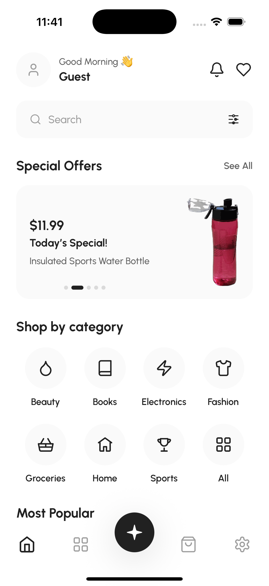
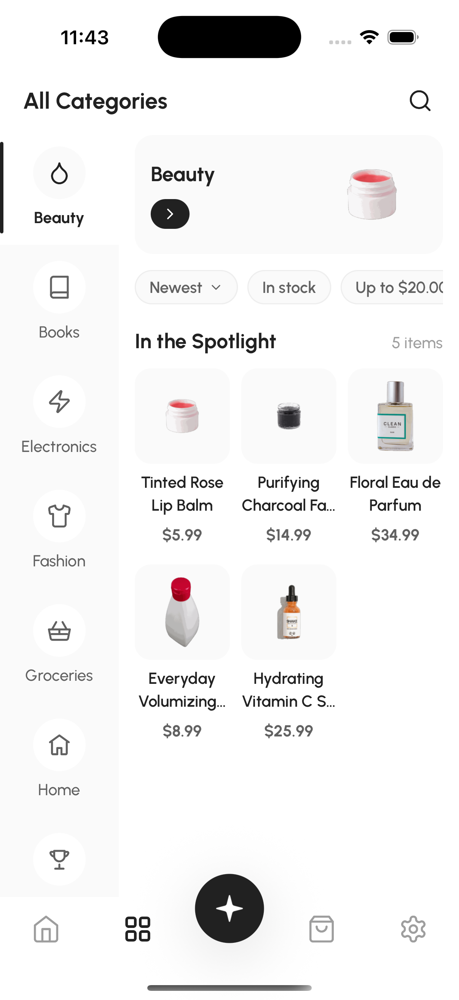
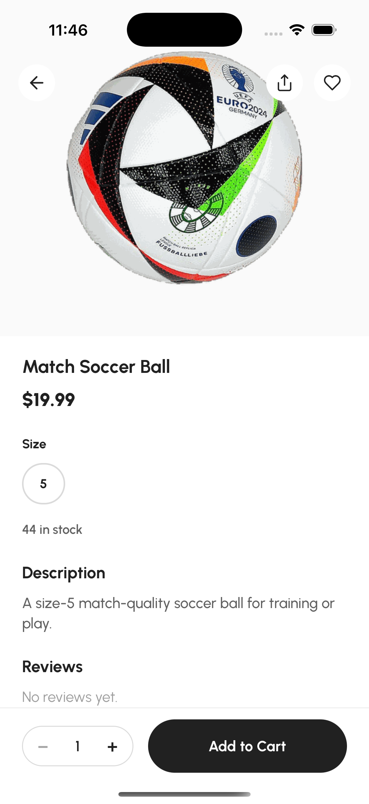
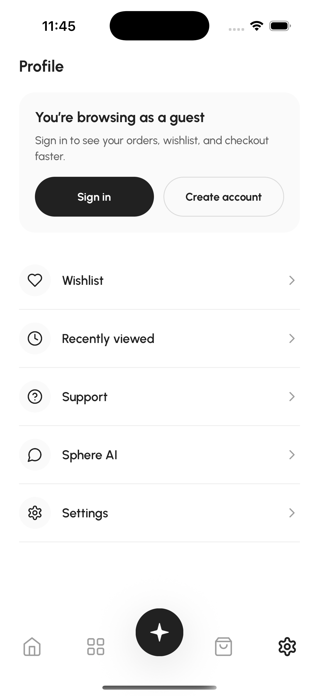
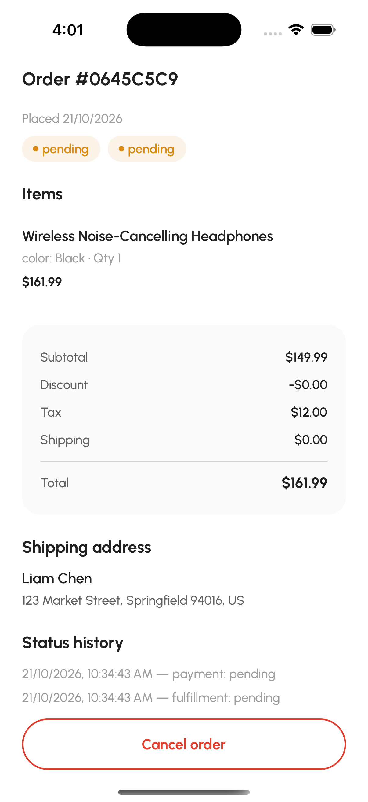

# ShopSphere AI

**Discover Better. Shop Smarter.**

A multi-vendor commerce platform: a React Native customer app, a React/Vite operations console for administrators, sellers and support agents, and an Express/MongoDB API behind both — with an AI layer that is grounded in real data by construction rather than by prompt instruction.

> **The mobile app lives in its own repository:** [Elango1734/ecommerce-mobile-app](https://github.com/Elango1734/ecommerce-mobile-app). This repository holds the API, the admin console, the shared packages and the design documents.

## Screens

| Home | Categories | Product detail |
| --- | --- | --- |
|  |  |  |

| Profile | Order detail |
| --- | --- |
|  |  |

## What is here

| Path | What it is |
| --- | --- |
| `apps/api` | Express REST API and the MongoDB/Mongoose data layer: auth, catalog, cart, checkout, payments, orders, seller and admin operations, reviews, support, notifications, storefront analytics, and the AI module |
| `apps/admin` | React 19 + Vite console. One build serves three role-scoped areas — administrator, seller, and support agent — behind route guards the API enforces independently |
| `packages/*` | `shared-types`, `validation` (Zod schemas shared by API and clients), `api-client` (the typed client both front ends use), `config` (design tokens) |
| `docs/` | Product requirements, architecture, database design, API specification, security, testing, deployment, and a task checklist tracking what is done and what is explicitly not |

## The AI layer

Every AI feature queries MongoDB first, computes a deterministic answer, and only then hands the model that finished object to narrate. The model gets no tool access, never decides what to retrieve, and its prose is never parsed back into data or actions. A model that invents a price or a product is a prompt defect to fix, not a trust boundary the system depends on.

Two consequences: every feature still works with the AI switched off, returning the deterministic text instead; and `AI_PROVIDER=development` (the default) runs a keyword-matching provider with no credentials at all.

**Shopper-facing:** discovery chat, product comparison, support chat with authenticated order status, extractive review summaries, related products, and user-deletable conversation history.

**Merchant-facing:** a daily store report — day-over-day revenue, orders, units and average order value, best sellers, stockout risk projected from 30-day velocity against available stock, slow movers, abandoned carts, the storefront conversion funnel, and ranked recommended actions. The actions are derived arithmetically, never generated.

## Running it

Prerequisites: Node.js 22 LTS, npm 10, and a MongoDB replica set (transactions are used, so a standalone server will not do).

```bash
npm install
cp .env.example .env            # then generate real secrets; see apps/api/README.md

# 1. MongoDB — replica set rs0 on port 27117
mongod --dbpath apps/api/.local-mongo/data --port 27117 --replSet rs0

# 2. API on :4000
npm run dev --workspace @shopsphere/api

# 3. Admin console on :5173
npm run dev --workspace @shopsphere/admin
```

Seed data with `npm run db:seed --workspace @shopsphere/api`. Per-app setup, test commands and known limitations are in [`apps/api/README.md`](apps/api/README.md) and [`apps/admin/README.md`](apps/admin/README.md).

## Testing

The API suite is 116 tests across 21 suites — unit, model, integration and HTTP — run against a real in-memory MongoDB replica set and the actual Express app, not mocks of either.

```bash
npm test --workspace @shopsphere/api
```

## Status and limitations

Live third-party payment and LLM integrations are not wired to real credentials; both run against clearly-labelled development simulators. Conversion analytics depend on the storefront emitting events, so a day with no traffic reports an absent conversion rate rather than zero. Feature-by-feature status and evidence are tracked in [the task checklist](docs/task-checklist.md) and should not be inferred from the directory layout.

## Documentation

- [Product requirements](docs/product-requirements.md)
- [Architecture](docs/architecture.md)
- [Database design](docs/database-design.md)
- [API specification](docs/api-specification.md)
- [Security](docs/security.md)
- [Testing](docs/testing.md)
- [Deployment](docs/deployment.md)
- [Entity and status glossary](docs/entity-status-glossary.md)
