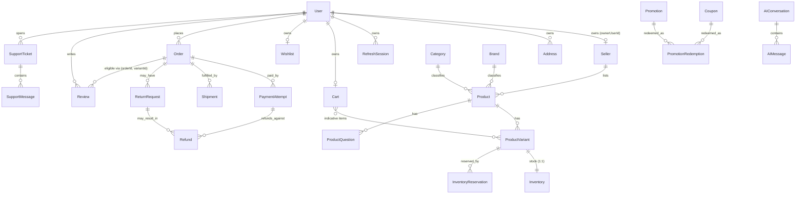

# Database Design

MongoDB with Mongoose is the persistence baseline. Collections below describe logical ownership, not final schemas. Embed bounded data read and written atomically with its owner; reference independently queried, high-cardinality, or separately authorized records. Avoid unbounded arrays and never expose a document directly as an API DTO.

## Core collections

| Collection | Key data and ownership |
| --- | --- |
| `users` | Identity, normalized email/phone, credential hash, roles, account state, preferences, timestamps. Never store plaintext passwords. |
| `refresh_sessions` | User, hashed refresh token, device/session metadata, expiry, revocation. |
| `addresses` | Customer-owned address records; access constrained to owner. Snapshot shipping address into order. |
| `sellers` | Seller profile, review status, business metadata, settings. Sensitive verification data access is restricted. |
| `categories`, `brands` | Configurable taxonomy and brand metadata. |
| `products` | Seller owner, category/brand references, descriptive content, specifications, moderation state, media references. |
| `product_variants` | Product/seller references, unique SKU, variant attributes, price, currency, sellable state. Inventory is variant/SKU scoped. |
| `inventory` | Variant/SKU, on-hand and reserved quantities, version/update fields. Mutations are conditional and transactional. |
| `carts` | Guest token hash or customer owner, item references and quantities, expiry/update fields. Prices are indicative only. |
| `wishlists`, `recently_viewed` | Customer-owned product references and bounded recency data. |
| `coupons`, `promotion_redemptions` | Promotion rules and redemption limits/ownership; enforce limits atomically. |
| `orders` | Customer, purchase-time line snapshots, totals, address snapshot, separate payment and fulfillment statuses, idempotency key, timestamps. |
| `inventory_reservations` | Checkout/order, variant, quantity, expiry and explicit lifecycle status. Expiry worker releases inventory transactionally. |
| `payments`, `refunds`, `webhook_events` | Provider references and state transitions; deduplicate provider event IDs; do not store card credentials. |
| `shipments`, `returns` | Order/seller fulfillment units, tracking events, return eligibility and lifecycle. |
| `reviews` | Customer, product, order-line verification reference, moderation state, rating/content. |
| `support_tickets`, `notifications` | Customer-owned support/notification records with scoped agent access and delivery state. |
| `audit_logs`, `outbox_events` | Append-oriented security/business audit and durable integration/event work. Restrict reads and redact sensitive fields. |

## Invariants and indexes

- Every persisted record has created/updated timestamps where mutable; API timestamps serialize as ISO 8601 UTC.
- Use ObjectId internally if convenient, mapped to stable string `id` in DTOs. Never serialize `_id`, `__v`, internal provider secrets, credential hashes, or private fields by default.
- Unique indexes: normalized user email as applicable, seller-scoped SKU, provider event ID, idempotency scope/key, and applicable promotion redemption keys.
- Query indexes should follow actual access paths: catalog state/category/seller, variant product/SKU, inventory variant, customer order chronology, seller fulfillment chronology, and session expiry. Add compound indexes from explain-plan evidence.
- Use TTL for expirable sessions and disposable records only where deleting the record is safe. TTL is asynchronous and must not enforce inventory release, payment expiry, or business transitions.
- Validate quantities and non-negative inventory at the service boundary and in atomic update predicates. Keep `available = onHand - reserved` consistent within transaction logic.

## Order snapshots and checkout

Each order line stores product/variant/seller IDs plus the purchase-time product name, SKU, selected attributes, unit price, discount, quantity, and line total. Store order-level item subtotal, discount, tax, shipping, grand total, and currency as integer minor units. Store calculation/promotion references needed for support and refunds. Snapshot address and applicable policy version; do not rely on subsequently mutable catalog data to render past purchases.

Checkout flow is an application-level transaction: reserve stock conditionally, recalculate cart pricing/promotions/tax/shipping server-side, create idempotent pending order/payment records and outbox work, then commit. On failure or reservation expiry, release inventory exactly once. External payment calls do not occur inside a long-running database transaction; use explicit pending states, idempotent provider requests, and verified asynchronous events to converge state.

## Data lifecycle

Define retention, deletion/anonymization, export, and backup policies before launch. Account deletion must preserve legally required financial/order records while minimizing or pseudonymizing personal data. Audit records have separately controlled retention. See [security](security.md) for sensitive-data handling.

## Implementation (apps/api/src)

The sections above described the logical design before implementation. This section documents what is actually built: 31 Mongoose collections, a connection/transaction layer, index management scripts, a migration runner, repositories, idempotent seed data, and 54 passing Jest tests (12 suites — see "Test results" below).

### File map

```text
apps/api/
  src/
    config/env.ts                  Zod-validated environment config
    db/
      connection.ts                 Connect + replica-set verification + graceful shutdown
      transaction.ts                 withTransaction() retry-safe session helper
      indexes.ts                     syncAllIndexes() / verifyAllIndexes()
      scripts/{syncIndexes,verifyIndexes}.ts
      migrations/                    Versioned migration framework + runner + 0001 example
      seed/run.ts                    Idempotent development seed (--reset to wipe first)
    models/
      shared/{money,address,statusHistory}.schema.ts   Shared embedded sub-schemas
      <31 *.model.ts files>          One per collection (see ERD + index table below)
      index.ts                       Barrel export
    repositories/                   Atomic / ownership-safe data access (see below)
    utils/{ids,money,session}.ts    ObjectId<->public-id mapping, Money arithmetic, session helper
  tests/
    unit/                           Pure utility tests
    models/                         Schema validation, unique constraints
    integration/                    Real replica-set transaction tests (mongodb-memory-server)
    setup/memoryReplSet.ts          Shared in-memory replica-set bootstrap for tests
```

Repositories (the data-access layer called by the future HTTP layer, never raw `Model` access from controllers):

| Repository | Responsibility |
| --- | --- |
| `user.repository.ts` | Argon2id password hashing; `registerCustomerAccount` hardcodes `roles: ['customer']` so public registration can never create a privileged account; `grantRole`/`revokeRole` are the only elevation path; login-attempt tracking; anonymization for account deletion. |
| `address.repository.ts` | Every read/write is scoped to `{ _id, ownerUserId }` — `AddressOwnershipError` on mismatch, soft delete. |
| `seller.repository.ts` | `assertSellerOwnership` is the mandatory check before any seller-scoped catalog/order mutation; also requires `status: 'active'`. |
| `product.repository.ts` | Bounded/indexed catalog listing with a stable tie-breaker sort; maintains the denormalized price-range/stock-visibility cache on Product from ProductVariant/Inventory. |
| `inventory.repository.ts` | Conditional-update `reserveStock` (the overselling guard), `commitReservation`, idempotent `releaseReservation`, expiry-worker `releaseExpiredReservations`. |
| `cart.repository.ts` | Guest-token hashing, dedupe-by-variant add/update, quantity cap, guest→user merge. |
| `discovery.repository.ts` | Atomic wishlist toggle; capped-recency `$push`+`$slice` for recently-viewed. |
| `coupon.repository.ts` | Atomic global-usage-limit redemption (`$inc` guarded by `usedCount < usageLimit`) plus the unique-index backstop against double redemption. |
| `order.repository.ts` | Idempotent order creation (unique `(customerId, checkoutIdempotencyKey)`), explicit payment/fulfillment state-machine guards. |
| `refund.repository.ts` | Hard enforcement that cumulative succeeded refunds never exceed the captured payment amount. |
| `review.repository.ts` | Verified-purchase eligibility check; incremental and full-recompute rating-aggregate maintenance. |
| `idempotency.repository.ts` | `Idempotency-Key` new/replay/409-conflict semantics backing the API contract. |
| `auditLog.repository.ts` | The only write path for audit entries; schema itself rejects updates (append-only). |

### Entity relationship diagram



### Embedding vs. referencing decisions

| Embedded (bounded, read/written with owner) | Referenced (separate collection) | Why |
| --- | --- | --- |
| `User.customerProfile`, `User.security` | `Seller` (via `ownerUserId`) | Customer profile is small/1:1; a seller has an independent moderation lifecycle and is queried by admins without loading a user. |
| `Product.images`, `.attributes`, `.ratingAggregate` | `ProductVariant`, `Inventory` | Images/attributes are capped (≤12/≤40) and always read with the product page; variants are high-cardinality and inventory mutates far more often than catalog content — isolating it avoids write contention. |
| `Order.items`, `.statusHistory`, address snapshots | `PaymentAttempt`, `Shipment`, `ReturnRequest`, `Refund` | Order line items/history are inherently bounded by cart size and lifecycle transitions; payments/shipments/returns/refunds each have independent lifecycles and 1-to-many cardinality against an order. |
| `Cart.items`, `Wishlist.items` (capped), `RecentlyViewed.items` (capped recency, `$slice`) | — | Bounded by validators + repository-enforced caps; always read/written as a unit with the owner. |
| `Shipment.trackingEvents`, `ReturnRequest.statusHistory`, `Refund.statusHistory` | `SupportMessage` (not embedded in `SupportTicket`) | Tracking/status history per document is small and append-only; a support conversation is open-ended and can grow large over a ticket's life, so it is a separate, paginated collection. |
| `ProductQuestion.answers` (capped ≤20) | — | A product Q&A thread is small by nature; contrast with support tickets above. |

### Index table

Every index below exists in the corresponding `*.model.ts` file; `npm run db:indexes:verify` confirms declared vs. actual indexes in a live deployment.

| Collection | Index | Reason |
| --- | --- | --- |
| users | `email` unique sparse | Login lookup; one account per email. |
| users | `phone` unique sparse | Login lookup; one account per phone. |
| users | `roles`, `status+createdAt` | Admin user listing/filtering. |
| refresh_sessions | `tokenHash` unique | Refresh-token lookup. |
| refresh_sessions | `userId+revokedAt` | "List/revoke my sessions". |
| refresh_sessions | `expiresAt` TTL | Safe cleanup of expired sessions only. |
| addresses | `ownerUserId+deletedAt+createdAt`, `ownerUserId+isDefault` | Address book listing; ownership-scoped by construction. |
| sellers | `ownerUserId` unique, `slug` unique, `status+createdAt` | One seller per owner account; storefront URL; admin review queue. |
| categories / brands | `slug` unique; `parentId+isActive+sortOrder` / `isActive+name` | Taxonomy lookup and active-item browsing. |
| products | `slug` unique | Product detail page lookup. |
| products | `moderationStatus+categoryId+createdAt`, `sellerId+moderationStatus+createdAt`, `brandId+moderationStatus`, `moderationStatus+minPriceMinor`, `moderationStatus+hasAvailableStock` | The catalog's actual filter/sort combinations (category browse, seller catalog, brand filter, price filter, in-stock filter), each scoped to published-only. |
| products | `name,description` text (weighted) | Search. |
| product_variants | `sellerId+sku` unique | SKU is unique per seller, not globally. |
| product_variants | `productId+status`, `sellerId+status` | Variant listing for a product; seller inventory listing. |
| inventory | `variantId` unique | 1:1 with variant. |
| inventory | `sellerId+onHand` | Low-stock / seller stock reports. |
| inventory_reservations | `variantId+status`, `checkoutId`, `status+expiresAt`, `cleanupAfter` TTL | Reservation lookup by variant/checkout; expiry-worker scan; safe disposal of already-terminal records only (never an active hold). |
| carts | `ownerUserId` unique sparse, `guestTokenHash` unique sparse, `expiresAt` TTL | One cart per owner/guest; guest-cart-only expiry. |
| wishlists | `ownerUserId` unique | One wishlist per customer. |
| recently_viewed | `ownerUserId` / `guestTokenHash` unique sparse, `expiresAt` TTL | One document per viewer. |
| coupons | `code` unique, `isActive+startsAt+expiresAt` | Code redemption lookup; active-coupon window query. |
| promotions | `isActive+startsAt+expiresAt+priority`, `eligibleCategoryIds` | Active-campaign lookup ordered by priority; category-targeted promotions. |
| promotion_redemptions | `(couponId\|promotionId)+userId+orderId` unique sparse, `(couponId\|promotionId)+userId` | Per-user/per-order redemption uniqueness and per-user usage counting. |
| orders | `customerId+checkoutIdempotencyKey` unique, `customerId+createdAt`, `sellerIds+fulfillmentStatus+createdAt`, `paymentStatus+createdAt` | Checkout idempotency backstop; customer order history; seller fulfillment queue (multikey on `sellerIds`); payment-status admin queries. |
| payment_attempts | `orderId+createdAt`, `provider+idempotencyKey` unique, `provider+providerPaymentRef` sparse | Order's payment history; provider-level idempotency; provider reference lookup. |
| webhook_events | `provider+providerEventId` unique, `status+createdAt` | Webhook dedupe (the core guarantee); processing queue. |
| shipments | `orderId`, `sellerId+status+createdAt`, `carrier+trackingNumber` sparse | Order's shipments; seller fulfillment queue; carrier tracking lookup. |
| returns | `orderId`, `customerId+createdAt`, `status+createdAt` | Order's returns; customer return history; admin review queue. |
| refunds | `orderId+createdAt`, `status+createdAt`, `providerRefundRef` sparse | Order's refund history; processing queue; provider reference lookup. |
| reviews | `orderId+orderItemVariantId` unique | **The** duplicate-review guard (one review per purchased line). |
| reviews | `productId+moderationStatus+createdAt`, `customerId+createdAt` | Product review listing; "my reviews". |
| product_questions | `productId+createdAt`, `askedBy+createdAt` | Product Q&A listing; "my questions". |
| notifications | `userId+readAt+createdAt`, `expiresAt` TTL | Notification inbox; disposable-record cleanup. |
| support_tickets | `customerId+createdAt`, `assignedAgentId+status+lastMessageAt`, `status+createdAt` | Customer ticket history; agent queue; admin triage. |
| support_messages | `ticketId+createdAt` | Paginated conversation thread. |
| audit_logs | `resourceType+resourceId+createdAt`, `actorUserId+createdAt`, `requestId` | "History for this resource"; "actions by this admin"; request correlation. |
| ai_conversations | `userId+createdAt`, `guestTokenHash+createdAt`, `retainUntil` TTL | Conversation history; user-controlled retention expiry. |
| ai_messages | `conversationId+createdAt`, `expireAt` TTL | Paginated transcript; per-conversation retention (not a fixed global TTL). |
| idempotency_records | `(principalId,scope,key)` unique, `expiresAt` TTL | The Idempotency-Key contract itself; disposable dedupe window. |
| outbox_events | `status+nextAttemptAt`, `cleanupAfter` TTL | Worker polling queue; cleanup only well after publication. |

No collection relies on an unbounded `find({})` for a catalog, order, or audit endpoint — `product.repository.ts`'s `listPublishedProducts` and `order.repository.ts`'s `listOrdersForCustomer`/`listOrdersForSeller` all paginate with a clamped page size and a deterministic `_id` tie-breaker.

### Setup instructions

See `apps/api/README.md` for the full local-replica-set bootstrap (no `mongosh` required — a short Node script using the `mongodb` driver initiates `rs.initiate()`). Summary: start `mongod --replSet rs0`, initiate the replica set once, point `MONGODB_URI` at it, `npm install`, then:

```bash
cd apps/api
npm run db:indexes          # create/update all declared indexes
npm run db:migrate          # apply any pending versioned migrations
npm run db:seed             # idempotent development seed data
```

### Seed data

`npm run db:seed` (idempotent — re-running does not duplicate data; `npm run db:seed:reset` wipes seeded collections first and refuses outside `development`/`test`) creates: 7 categories, 4 brands, 2 sellers (each with an owner user), 4 products across 4 categories with 7 variants total and matching inventory rows, 2 demo coupons (percentage + fixed) and 1 demo promotion, 3 demo customers with addresses, 3 orders in distinct states (`delivered`+`paid` with a succeeded payment attempt, `pending` payment, `cancelled`), and 1 demo review (`isDemoData: true`) on the delivered order's purchased variant. A development administrator is **only** created if `SEED_ADMIN_EMAIL`/`SEED_ADMIN_PASSWORD` are set in the local `.env` — unset, that step is skipped and logged, never defaulted.

Verified in this environment: ran against a local single-node `mongod --replSet rs0` twice back-to-back; document counts were identical both times (confirming idempotency), and the transactional order+payment-attempt creation inside the seed script committed successfully.

### Test results

`npm test` (Jest, `ts-jest` ESM, `mongodb-memory-server` real replica sets for integration tests — transactions are exercised, not mocked, per `testing.md`):

```text
Test Suites: 12 passed, 12 total
Tests:       54 passed, 54 total
Time:        ~41s
```

Coverage by high-risk case (testing.md):

- **Overselling** (`tests/integration/inventory.concurrency.spec.ts`): concurrent reservations against 1-unit and 5-unit stock never exceed availability; commit/release/expiry-release are each exercised, including idempotent double-release.
- **Checkout idempotency** (`tests/integration/order.checkout.spec.ts`): duplicate `(customerId, checkoutIdempotencyKey)` rejected both sequentially and under concurrent `Promise.all`; payment/fulfillment state-machine guards reject invalid jumps.
- **Idempotency-Key contract** (`tests/integration/idempotency.spec.ts`): new/replay/409-conflict semantics, per-principal/per-scope isolation, concurrent first-call race resolved to exactly one "new".
- **Coupon usage limits** (`tests/integration/coupon.spec.ts`): exactly `usageLimit` concurrent redemptions succeed, the rest rejected; duplicate redemption for the same order rejected by the unique-index backstop.
- **Refund cap** (`tests/integration/refund.spec.ts`): a refund exceeding the captured amount is rejected, as is a partial refund that would push cumulative succeeded refunds over the cap; a refund against a non-succeeded payment attempt is rejected.
- **Ownership boundaries** (`tests/integration/ownership.spec.ts`): address read/update/delete across users rejected; seller-ownership assertion rejected for a non-owner and for a non-active seller.
- **Cart merge** (`tests/integration/cart.merge.spec.ts`): quantity summed on matching variant, appended on new variant, idempotent re-merge, per-line quantity cap.
- **Schema validation / unique constraints** (`tests/models/*.spec.ts`): user email/phone requirement and uniqueness, public registration's forced `roles: ['customer']`, password hashing, product image cap, SKU uniqueness scoped per seller, sale-price-exceeds-regular-price rejection, duplicate-review unique index, coupon field/date validation.

Also independently verified against the live local replica set: `npm run db:indexes` (idempotent, reran twice), `npm run db:indexes:verify` (confirms every declared index exists, including the catalog text index via its real `_fts` key shape), `npm run db:migrate` (applies the example migration once, no-ops on rerun).

### Known limitations

- Built/tested on Node 20.20.0, not the pinned Node 22 LTS — re-verify on 22 before treating this as a release baseline.
- No HTTP layer yet: these are repositories, not endpoints. A later stage must add Express routes/controllers that call them, map results to DTOs (never raw Mongoose documents), and enforce the authentication/authorization context these repositories assume their caller already has (e.g. `assertSellerOwnership`, address ownership checks take an already-authenticated `userId` as a parameter — they do not themselves authenticate anyone).
- Several lifecycle enums introduced here (`AccountStatus`, `ProductModerationStatus`, variant/shipment/ticket statuses, etc.) are DB-layer internal and not yet mirrored in `packages/shared-types`; when the API layer makes any of them client-visible, add the matching type there and keep both in sync.
- `applyRatingDelta`'s incremental maintenance can drift under rare interleavings (e.g. two concurrent approvals of different reviews updating the same bucket); `recomputeRatingAggregate`'s full aggregation pipeline is the documented corrective path and should run periodically or after moderation bulk-actions.
- The outbox worker, inventory-reservation expiry worker, and AI-message retention sweep are implemented as callable repository functions (`releaseExpiredReservations`, outbox's `status+nextAttemptAt` index) but no scheduler/cron process invokes them yet — that belongs to the API/runtime stage.
- No real MongoDB Atlas/managed deployment, backup/restore drill, or production replica-set topology has been configured or tested — only a local single-node dev replica set and `mongodb-memory-server` for tests, consistent with `deployment.md`'s statement that production configuration is out of scope for this stage.